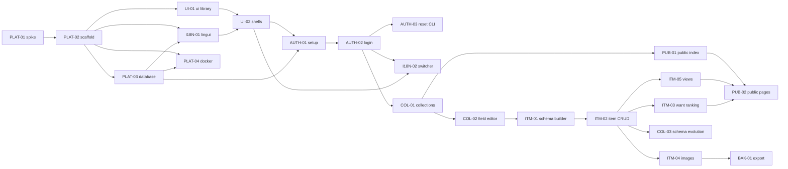

# v1: build order and status

Progress: **21 / 22 done**

Work top to bottom. A ticket can start once everything in **Needs** is ✅. Rows marked ‖ can run in parallel with
the row above.

**Status:** ⬜ todo · 🔄 in progress · ⛔ blocked · ✅ done

This table is the source of truth for status. When a ticket is ✅, also tick its checkbox in its area's
`overview.md`, update the progress count above, and set the ticket's `Released in:` to `v1`.

| # | Ticket | Title | Milestone | Needs | Status |
|---|---|---|---|---|---|
| 1 | [PLAT-01](../../platform/tickets/TICKET-PLAT-01-stack-spike.md) | Stack spike (throwaway) | M0 Prove the stack | none | ✅ |
| 2 | [PLAT-02](../../platform/tickets/TICKET-PLAT-02-project-scaffold.md) | Project scaffold | M1 Foundation | PLAT-01 | ✅ |
| 3 | [PLAT-03](../../platform/tickets/TICKET-PLAT-03-database-and-migrations.md) | Database, migrations, initial schema | M1 Foundation | PLAT-02 | ✅ |
| 4 ‖ | [UI-01](../../ui/tickets/TICKET-UI-01-ui-library-foundation.md) | UI library foundation | M1 Foundation | PLAT-02 | ✅ |
| 5 | [I18N-01](../../i18n/tickets/TICKET-I18N-01-lingui-setup.md) | Lingui setup and locale resolution | M1 Foundation | PLAT-02, PLAT-03 | ✅ |
| 6 | [UI-02](../../ui/tickets/TICKET-UI-02-app-shells.md) | App shells and error pages | M1 Foundation | UI-01, I18N-01 | ✅ |
| 7 ‖ | [PLAT-04](../../platform/tickets/TICKET-PLAT-04-docker-deployment.md) | Docker image and deploy notes | M1 Foundation | PLAT-02, PLAT-03 | ✅ |
| 8 | [AUTH-01](../../auth/tickets/TICKET-AUTH-01-first-run-setup.md) | First-run setup | M2 Admin access | PLAT-03, UI-02, I18N-01 | ✅ |
| 9 | [AUTH-02](../../auth/tickets/TICKET-AUTH-02-login-and-sessions.md) | Admin login, sessions, request guards | M2 Admin access | AUTH-01 | ✅ |
| 10 | [AUTH-03](../../auth/tickets/TICKET-AUTH-03-reset-password-cli.md) | Password reset CLI | M2 Admin access | AUTH-02 | ✅ |
| 11 ‖ | [I18N-02](../../i18n/tickets/TICKET-I18N-02-locale-switcher-and-default.md) | Locale switcher and default locale | M2 Admin access | I18N-01, UI-02, AUTH-02 | ✅ |
| 12 | [COL-01](../../collections/tickets/TICKET-COL-01-collection-management.md) | Collection management | M3 Collections and fields | AUTH-02, UI-02 | ✅ |
| 13 | [COL-02](../../collections/tickets/TICKET-COL-02-field-editor.md) | Field editor | M3 Collections and fields | COL-01 | ✅ |
| 14 | [ITM-01](../../items/tickets/TICKET-ITM-01-item-schema-builder.md) | Item schema builder | M3 Collections and fields | COL-02 | ✅ |
| 15 | [ITM-02](../../items/tickets/TICKET-ITM-02-item-crud.md) | Create, edit and delete items | M4 Items | ITM-01 | ✅ |
| 16 | [ITM-05](../../items/tickets/TICKET-ITM-05-collection-views.md) | Collection views: table, grid, search, sort, filter | M4 Items | ITM-02 | ✅ |
| 17 ‖ | [ITM-03](../../items/tickets/TICKET-ITM-03-want-ranking.md) | Reorder wants | M4 Items | ITM-02 | ✅ |
| 18 ‖ | [ITM-04](../../items/tickets/TICKET-ITM-04-item-images.md) | Item images | M4 Items | ITM-02 | ✅ |
| 19 ‖ | [COL-03](../../collections/tickets/TICKET-COL-03-schema-evolution.md) | Field type changes and option edits | M4 Items | COL-02, ITM-02 | ✅ |
| 20 | [PUB-01](../../sharing/tickets/TICKET-PUB-01-public-index.md) | Public index of collections | M5 Sharing | COL-01, UI-02 | ✅ |
| 21 | [PUB-02](../../sharing/tickets/TICKET-PUB-02-public-collection-pages.md) | Public have and want pages | M5 Sharing | ITM-05, ITM-03, PUB-01 | ✅ |
| 22 | [BAK-01](../../backup/tickets/TICKET-BAK-01-export-zip.md) | Full export as zip | M6 Backup | ITM-04 | ⬜ |

## Why this order

- **PLAT-01 first.** Every layer of the stack is experimental, so its findings can change the scaffold, the i18n
  setup and how public pages avoid client JS.
- **ITM-05 before ITM-03.** The reorder controls live inside the want-tab list that ITM-05 builds.
- **PUB-01 can start any time after COL-01.** It's listed late only because PUB-02 needs the items work first.
- **BAK-01 last.** Its round-trip test needs images to exist.

## Milestones

| Milestone | Done when |
|---|---|
| M0 Prove the stack | Spike results recorded, versions pinned, go/no-go per layer |
| M1 Foundation | A translated, styled shell runs from a Docker image with a migrated DB |
| M2 Admin access | The owner can set up, log in, switch language and recover the password |
| M3 Collections and fields | Collections with custom fields can be defined |
| M4 Items | Items with images, have/want, ranks, views and safe schema changes |
| M5 Sharing | Public index and have/want pages, with private fields never leaked |
| M6 Backup | Full zip export |

## Dependency graph

## Not in v1

| Ticket | Title | Why later |
|---|---|---|
| [BAK-02](../../backup/tickets/TICKET-BAK-02-restore-from-zip.md) | Restore from export zip | v2 by decision |
| [IMP-01](../../import/tickets/TICKET-IMP-01-csv-import.md) | CSV import with column mapping | v2; needs a design session first |
| [IMP-02](../../import/tickets/TICKET-IMP-02-catalog-lookups.md) | Catalog lookups | v2; needs a design session first |
